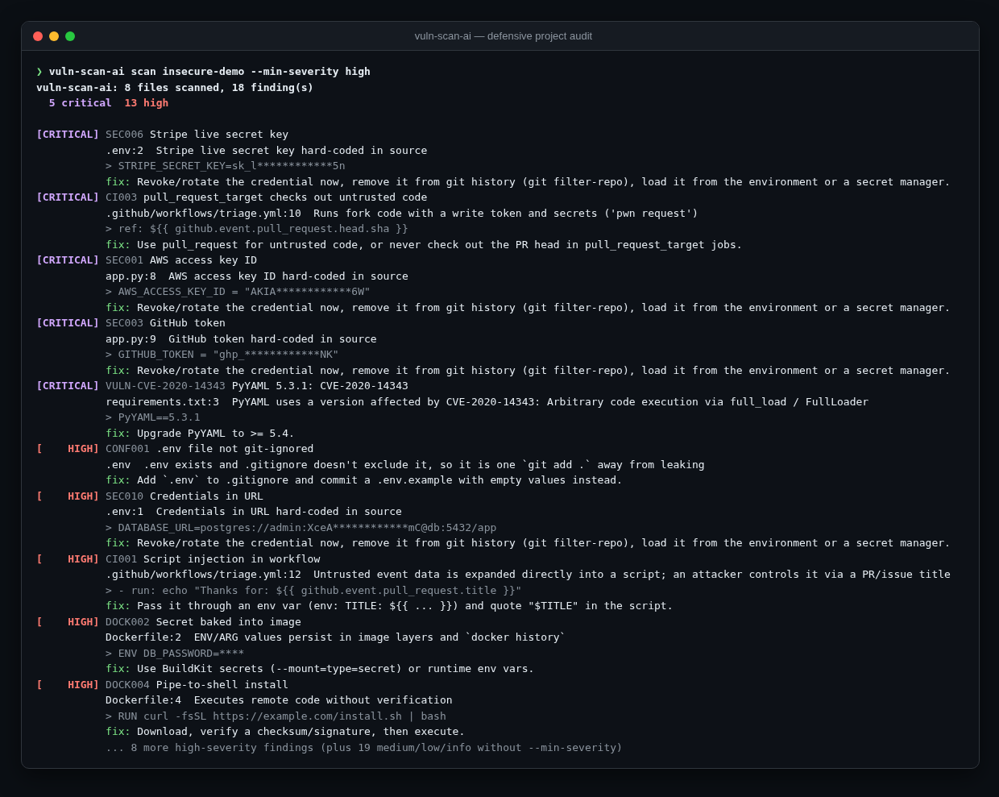

<div align="center">

# 🔐 vuln-scan-ai

**A defensive project auditor. It finds hard-coded secrets, vulnerable or unpinned dependencies, and risky
Dockerfile, docker-compose, GitHub Actions and code patterns before they ship. Optional AI remediation advice.**

[](https://github.com/hbtabi/vuln-scan-ai/actions/workflows/ci.yml)


[](LICENSE)

</div>

`vuln-scan-ai scan .` gives you the review a security-minded colleague would do on a pull request: *"that's a
live Stripe key in `.env`, the Dockerfile runs as root and pipes curl into bash, PyYAML 5.3.1 has an RCE,
and this workflow lets anyone inject shell through a PR title."* Every finding comes with a file:line, a redacted
snippet and a concrete fix.

> **Defensive only.** This tool audits code you own. It doesn't exploit, probe remote hosts or test
> credentials, and secrets are redacted before they reach any output or the optional LLM.

## 📸 Demo

<p align="center"></p>

Try it yourself with `vuln-scan-ai demo`. It generates a deliberately insecure sample project in a temp dir
(its fake credentials are created at runtime, so this repo holds no secret-shaped strings) and scans it.

## ✨ What it checks

| Area | Examples | Rule IDs |
|---|---|---|
| **Secrets** | AWS keys, GitHub/Slack/Stripe/Google/OpenAI-style tokens, private keys, JWTs, `user:pass@` URLs, entropy-gated `password = "..."`, values in committed `.env` files | `SEC001–010`, `SEC100` |
| **Dependencies** | unpinned `requirements.txt`, `*`/`latest` npm ranges, URL/VCS installs, `postinstall` that pipes curl to sh, known advisories (offline sample DB, or live [osv.dev](https://osv.dev) with `--osv`) | `DEP001–004`, `VULN-*`, `OSV` |
| **Dockerfile** | unpinned/`latest` base image, secrets in `ENV`/`ARG`, `ADD <url>`, `curl \| sh`, `chmod 777`, `EXPOSE 22`, running as root | `DOCK001–008` |
| **docker-compose** | `privileged`, host networking, Docker socket / host-root mounts, DB ports published on `0.0.0.0` | `COMP001–004` |
| **GitHub Actions** | script injection via `${{ github.event.*.title }}`, `pull_request_target` + PR checkout ("pwn request"), unpinned third-party actions, `write-all` | `CI001–004` |
| **Code (Py/JS/TS)** | `yaml.load`, `pickle.loads`, `verify=False`, `shell=True`, `eval`, f-string SQL, debug mode, `innerHTML`, `rejectUnauthorized: false`, `exec` with interpolation | `CODE0xx`, `CODE1xx` |
| **Project hygiene** | `.env` present but not git-ignored, no `.env.example` | `CONF001–002` |

**Outputs:** coloured text, `--format json`, `--format markdown` (paste into a PR), `--format sarif` (GitHub code
scanning). `--fail-on high` gives a CI gate, `--min-severity` filters noise, `# vulnscan:ignore` suppresses a single
line, and `.vulnscanignore` excludes paths.

## 🚀 Quick start

```bash
git clone https://github.com/hbtabi/vuln-scan-ai && cd vuln-scan-ai
python -m venv .venv && source .venv/bin/activate
pip install -e ".[dev]"

vuln-scan-ai demo                               # see it on a deliberately insecure project
vuln-scan-ai scan ~/code/my-app                 # audit your own project
vuln-scan-ai scan . --osv                       # + live vulnerability lookup for pinned deps
vuln-scan-ai scan . --format sarif -o vulnscan.sarif
vuln-scan-ai scan . --fail-on high              # non-zero exit for CI
```

**AI remediation advice** (optional, any OpenAI-compatible endpoint):

```bash
export OPENAI_API_KEY=...            # see .env.example; OPENAI_BASE_URL works for Groq/Together/Ollama/LM Studio
vuln-scan-ai scan . --explain        # adds an "ai:" line to the top high/critical findings
```

Only the rule, file name, message and the *already redacted* snippet go to the model, never file contents or raw secrets.

**Use it in GitHub Actions with code scanning:**

```yaml
- run: pip install git+https://github.com/hbtabi/vuln-scan-ai
- run: vuln-scan-ai scan . --format sarif -o vulnscan.sarif
- uses: github/codeql-action/upload-sarif@v3
  with: { sarif_file: vulnscan.sarif }
```

## 🗂️ Project structure

```
vulnscan/
  checks/secrets.py   provider patterns + entropy-gated generic rule + redaction
  checks/deps.py      requirements.txt / package.json, offline advisories, osv.dev batch client
  checks/docker.py    Dockerfile (with line continuations) + docker-compose
  checks/ci.py        GitHub Actions workflow checks
  checks/code.py      risky Python / JS patterns
  scanner.py          file walking, dispatch, project-level checks, ignores
  report.py           text / JSON / Markdown / SARIF
  llm.py              optional OpenAI-compatible remediation advice
  demo.py             generates the insecure sample project at runtime
  data/advisories.json  small offline advisory sample
tests/                25 pytest tests; fake secrets are generated at runtime
```

## 🛣️ Roadmap

- [ ] Lockfile support (`package-lock.json`, `poetry.lock`, `uv.lock`) for exact resolved versions
- [ ] Git history scanning for secrets that were committed and then deleted
- [ ] Terraform / Kubernetes manifest checks (public S3 buckets, `hostPath`, `runAsRoot`)
- [ ] AST-based Python checks to cut false positives on the code rules
- [ ] Baseline file to accept existing findings and only fail on new ones

## ⚠️ Limitations

- **The offline advisory DB is a sample of ten well-known CVEs**, there so the tool works without network and so
  the tests are deterministic. For a real vulnerability picture use `--osv` (or pip-audit / npm audit).
- Code checks are regex-based hints, not data-flow analysis. Expect some false positives (and false negatives).
  Use `# vulnscan:ignore` for reviewed lines.
- Secret detection can't know whether a key is live. Treat every hit as compromised until it's rotated.
- npm ranges like `^0.21.0` are judged by their lower bound ("may resolve to"). Lockfiles aren't parsed yet.
- No findings doesn't mean secure. This complements code review, dependency bots and proper SAST.

## 📄 License

[MIT](LICENSE) © 2026 Mohammed Hassan bin Tayyeb
